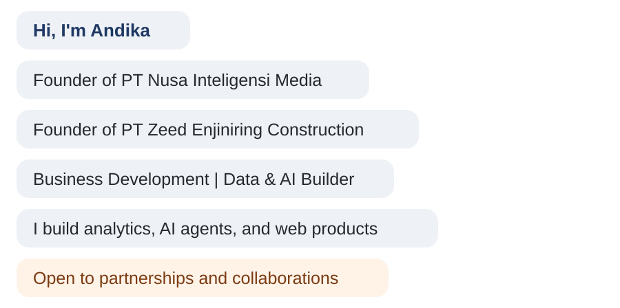

  

  

### Hi there 👋

<h4 align="center">My portfolio website: <a href="https://andikapratamazaid.github.io">andikapratamazaid.github.io</a></h4>

<h4 align="center">Business Development for new ventures, partnerships, and agribusiness, with hands-on data and AI projects</h4>

  
  
  

---

# 📊 GitHub Stats and Activity

  
  

  

  

---

# 💻 My Favorite Tools and Technologies

  <table align="center">
    <tr>
      <td align="center" width="96">
        
         Python
      </td>
      <td align="center" width="96">
        
         Pandas
      </td>
      <td align="center" width="96">
        
         NumPy
      </td>
      <td align="center" width="96">
        
         Scikit-learn
      </td>
      <td align="center" width="96">
        
         Jupyter
      </td>
      <td align="center" width="96">
        
         PostgreSQL
      </td>
      <td align="center" width="96">
        
         MySQL
      </td>
    </tr>
    <tr>
      <td align="center" width="96">
        
         Git
      </td>
      <td align="center" width="96">
        
         GitHub
      </td>
      <td align="center" width="96">
        
         VS Code
      </td>
      <td align="center" width="96">
        
         HTML
      </td>
      <td align="center" width="96">
        
         CSS
      </td>
      <td align="center" width="96">
        
         JavaScript
      </td>
      <td align="center" width="96">
        
         Matplotlib
      </td>
    </tr>
  </table>

Also in daily use: SQL · Google Sheets · Microsoft Excel · Financial Modelling (NPV, IRR, Payback) · Google Analytics

---

# 🤝 Connect with Me

  
  
  

<i>Building digital products and web apps with AI, one project at a time.</i>

